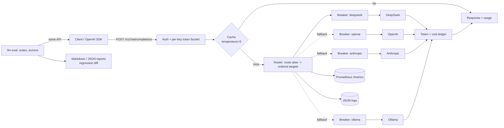

# llm-gateway

[](https://github.com/tommyshamamba/llm-gateway/actions/workflows/ci.yml)

An OpenAI-compatible gateway in front of **DeepSeek, OpenAI, Anthropic and Ollama**, with
provider fallback, retries and per-provider circuit breakers, per-key rate limiting, a response
cache, streaming (SSE), token and cost accounting, Prometheus metrics, structured JSON logs, and an
**eval harness** for comparing models and catching regressions.

Point any OpenAI SDK at it by changing `base_url`; the gateway picks a healthy upstream.



## Features

| Area | What it does |
|---|---|
| API | `POST /v1/chat/completions` (incl. `stream: true`), `GET /v1/models`, `GET /v1/usage`, `/healthz`, `/readyz`, `/metrics` |
| Providers | OpenAI-compatible (OpenAI, DeepSeek, vLLM, …), Anthropic Messages API, Ollama `/api/chat`; responses normalised to OpenAI shapes |
| Resilience | Ordered fallback chain per model alias; jittered exponential retries for retryable errors (timeouts, connection errors, 408/429/5xx); circuit breaker per provider (closed → open → single-probe half-open); client errors (400/413/422) are returned, not failed over; streaming fails over until the first chunk |
| Limits | Token bucket per client key (`rpm`, `burst`), `429` with `Retry-After` |
| Cache | LRU + TTL for deterministic requests (`temperature: 0`) or `cache: true`; cache hits cost $0 |
| Accounting | Prompt/completion tokens (from the provider, estimated if missing) and USD cost from per-model pricing; per-key ledger at `/v1/usage` |
| Observability | Prometheus counters/histograms (requests, upstream attempts by outcome, latency, failovers, tokens, cost, cache, breaker state); one JSON log line per request with `request_id`, provider, attempts, usage |
| Evals | YAML prompt suites, scorers (`exact`, `contains`, `regex`, `numeric`, `json_valid`), multi-model comparison, regression report with non-zero exit on score drop |

## Quick start

```bash
pip install -e '.[dev]'
pytest -q                                  # 30 tests, mock providers only, no API keys

# keyless demo stack: gateway + two fault-injectable mock providers
docker compose up --build
curl -s localhost:8080/v1/chat/completions \
  -d '{"model":"smart","messages":[{"role":"user","content":"What is 2 + 2?"}]}'
curl -s -X POST localhost:9001/_faults -d '{"mode":"error","status":503}'   # break the primary
curl -s localhost:8080/v1/chat/completions \
  -d '{"model":"smart","messages":[{"role":"user","content":"hi"}]}' | jq .x_gateway
# {"provider":"secondary","model":"mock-smart","attempts":2,"failover":true}

# with a local model
docker compose --profile ollama up --build
docker compose exec ollama ollama pull llama3.2:1b
```

Real providers: copy `config/gateway.yaml`, export the env vars it names
(`DEEPSEEK_API_KEY`, `OPENAI_API_KEY`, `ANTHROPIC_API_KEY`, `GATEWAY_KEY_DEFAULT`, …) and run
`llm-gateway --config config/gateway.yaml`. Keys are only ever read from the environment.

```python
from openai import OpenAI
client = OpenAI(base_url="http://localhost:8080/v1", api_key="<gateway key>")
client.chat.completions.create(model="chat-default", messages=[{"role": "user", "content": "hi"}])
```

## Eval harness

```bash
llm-eval run --suite evals/suites/basic.yaml --models smart,sloppy --base-url http://localhost:8080/v1
llm-eval compare reports/baseline.json reports/basic.json --max-drop 0.02   # exit 1 on regression
```

Example output against the two mock models ([full report](evals/SAMPLE_REPORT.md)):

| Model | Score | Passed | Errors | Tokens (in/out) | Cost USD |
|---|---|---|---|---|---|
| smart | 100.00% | 10/10 | 0 | 154/39 | 0.000232 |
| sloppy | 40.00% | 4/10 | 0 | 154/27 | 0.000104 |

## Benchmarks (measured, mock providers)

`python bench/bench.py --n 2000` runs the gateway and two mock providers as separate local
processes and measures sequential request latency. Full table: [bench/RESULTS.md](bench/RESULTS.md).

**Hardware:** Intel Xeon (cloud VM), 8 vCPU, 16 GiB RAM, Linux 6.12, Python 3.12.

| Scenario | p50 | p99 |
|---|---|---|
| Direct to mock (baseline) | 0.90 ms | 1.76 ms |
| Through gateway | 2.44 ms | 3.33 ms |
| Primary returns HTTP 503 → served by secondary | 3.85 ms | 6.91 ms |
| Primary process killed (connection refused) → secondary | 3.38 ms | 5.00 ms |
| Breaker open (primary skipped) | 2.52 ms | 3.42 ms |
| Primary hangs, `timeout_s: 0.25` → secondary | 256 ms | 260 ms |

- Gateway overhead: **~1.5 ms p50** per request.
- Failover on a hard upstream failure: **~1–1.4 ms added** (p50); once the breaker opens, **~0.1 ms**.
- A hung upstream costs exactly its configured timeout, then fails over.

These isolate gateway cost; with real LLMs (hundreds of ms or more per call) the overhead is noise.

## Deploy

- `Dockerfile`: multi-stage, runs as UID 10001, works with a read-only root filesystem.
- `deploy/k8s/`: kustomize base with Deployment (restricted PSS, probes on `/healthz` and `/readyz`),
  Service, HPA, PDB, NetworkPolicy, ServiceMonitor, ConfigMap. Keys come from a Secret you create
  out-of-band.
- CI (`.github/workflows/ci.yml`): ruff + pytest on Python 3.11–3.13, benchmark smoke run, eval demo,
  Docker build + non-root check, kubeconform manifest validation, gitleaks.

See [DESIGN.md](DESIGN.md) for the failure model and trade-offs.

## License

MIT
